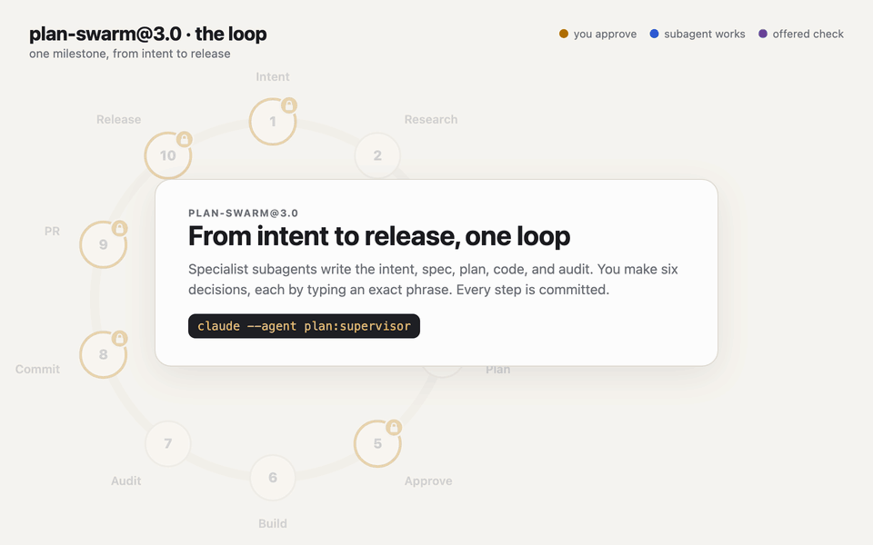

# Plan Swarm: an AI-native SDLC for Claude Code

A disciplined swarm of role agents, deliberative panels, and adversarial validators that takes a feature, bug fix, or refactor through **intent → spec → plan → parallel build → audit → commit → pull request → release**, with a hook-enforced control plane: nothing is committed, pushed, or tagged without the user's exact approval phrase, and every approval is recorded in git.

This repository is built for **Claude Code** and **Claude models**. The swarm ships as one plugin, `plan` (plan-swarm@3.0), in two packagings generated from a single source per role: skills (invoked via the Skill tool) and subagents (via the Agent tool, auto-delegation, or `claude --agent`).

<picture>
  <source media="(prefers-color-scheme: dark)" srcset="images/lifecycle/plan-swarm-loop-dark.gif">
  
</picture>

---

## See it in action

| | Artifact | What it shows |
|---|---|---|
| ▶ | [Loop animation](images/lifecycle/plan-swarm-loop-light.gif) | The loop above: stages, gates, and the audit rework path (37 s). |
| 🖱 | [Loop stepper](images/lifecycle/plan-swarm-loop-stepper.html) | The same loop, one stage per click, with speaker notes. For presenting. Download and open locally. |
| 🎬 | [Loop video](images/lifecycle/plan-swarm-loop-light.mp4) ([dark](images/lifecycle/plan-swarm-loop-dark.mp4)) | About 10 s per stage, pausable (1:56). |
| ▶ | [Terminal replay](images/terminal-replay/plan-swarm-terminal.gif) | One milestone recorded from a real run: commands, gate blocks, approvals (44 s). |
| 🖱 | [Interactive explainer](images/explainer/plan-swarm-explainer.html) | 18 steps across you, the supervisor, the roles, and git. Download and open locally (GitHub shows HTML as source). |
| 📄 | [Cheat sheet](images/cheatsheet/plan-swarm-cheatsheet-light.svg) ([dark](images/cheatsheet/plan-swarm-cheatsheet-dark.svg), [PNG](images/cheatsheet/plan-swarm-cheatsheet-light.png)) | One page: setup, phrases, rules, troubleshooting. |

---

## Quick start

```bash
/plugin marketplace add ddobrin/plan-skills-claude
/plugin install plan@plan-skills
```

Until 3.0 is published to the marketplace, the installed plugin is the older 2.1 (no `swarm-init`). Load the 3.0 plugin from a checkout instead, with `claude --plugin-dir <checkout>/plugins/plan`, and disable the installed `plan@plan-skills` in the `/plugin` menu.

Then, in the repository you want the swarm to work on:

1. Type **`/plan:swarm-init`**. It installs `plans/swarm.md` (settings), three git hooks (`pre-commit`, `pre-merge-commit`, `pre-push`), and optionally `REVIEW.md`, a CI workflow, and an `AGENTS.md` skeleton (skipped if the repository already has a `CLAUDE.md`, which the swarm reads instead). It never overwrites files.
2. Fill in your build and test commands in `AGENTS.md` (or your existing `CLAUDE.md`), review `plans/swarm.md`, and commit both. If the repository has both files, put `@AGENTS.md` at the top of `CLAUDE.md`: Claude Code reads `AGENTS.md` only when there is no `CLAUDE.md`, or when `CLAUDE.md` imports it.
3. Start Claude Code as the supervisor, **`claude --agent plan:supervisor`**, and describe what you want. The supervisor dispatches every role as a subagent with its own context; type the approval phrases in this main session. (Saying "be the supervisor" in any session also works.)

The plugin's hooks enforce approvals only in repositories that have `plans/swarm.md`.

---

## Documentation

| Document | For |
|---|---|
| [`docs/playbook.html`](docs/playbook.html) | Developers: the stage-by-stage guide, approval phrases, and troubleshooting. |
| [`docs/usage-e2e.html`](docs/usage-e2e.html) | Developers: one milestone end to end with the real hook, gate, and git outputs (regenerate with `python3 examples/e2e_demo.py`). |
| [`docs/walkthrough.html`](docs/walkthrough.html) | Reviewers: what changed from plan-swarm@2.1 to 3.0, why, and the review order. |
| [`docs/ai-dlc.html`](docs/ai-dlc.html) | Everyone: the AI-native SDLC as implemented, how it maps to Anthropic's playbook, and how to verify it. |
| [`plugins/plan/README.md`](plugins/plan/README.md) | Skills, control plane, artifact map, configuration. |
| [`plugins/plan/SUBAGENTS.md`](plugins/plan/SUBAGENTS.md) | Subagent specifics. |
| [`plugins/plan/topology.md`](plugins/plan/topology.md) | The plan-swarm@3.0 graph (machine-readable). |
| [`docs/architecture.html`](docs/architecture.html) · [`docs/implementation-plan.html`](docs/implementation-plan.html) · [`docs/feasible.html`](docs/feasible.html) | Design record: target architecture, build plan, and the original feasibility assessment. |
| [`images/README.md`](images/README.md) | The visual artifacts above and how to rebuild them. |
| [`AGENTS.md`](AGENTS.md) | Agents editing this repository. |

The `multi-agent/` directory holds standalone write-ups of the advisor, orchestrator, and advisor-orchestrator-worker patterns; they are not part of the plugin.

---

## Models

Every role inherits the session's model and effort level. To run a role on a different tier, set `model` (and optionally `effort`) in that role's agent front matter in `plugins/plan/roles/{name}.md` and regenerate with `python3 plugins/plan/lib/render_roles.py`.
